# renpy-android-runtime

一个独立的 Android 应用，用来运行设备文件夹里的 Ren'Py 8.6 游戏，作为 [Tyranor Next](https://github.com/Weiss-UltimateSavior/Tyranor-Next) 的运行时模块使用。

> **Tyranor Next 不是 Tyranor。** Tyranor Next 是参照 Tyranor 模拟器逆向重写的另一个应用，有自己的包名、界面和更新；第三方运行时模块的协议是 Tyranor Next 定义的。本运行时只面向 Tyranor Next：它的安装、启用、扫描和启动都在 Tyranor Next 里完成，不能在 Tyranor 里使用，也不能单独打开游戏。

Ren'Py 官方的 Android 支持（RAPT）会把一个游戏打包成一个 APK。本应用原样保留 Ren'Py 自己的引擎和 Android 代码，只是让它去读取共享存储里的游戏。它实现了 Tyranor Next 的第三方运行时模块协议（见 [PROTOCOL.md](PROTOCOL.md)）：Tyranor Next 通过包名和启动 action 发现它，按它声明的扫描描述识别 Ren'Py 8.6 及以后版本的游戏，再把游戏文件夹交给它启动。

- Ren'Py **8.6.1.26111705**（SDL3、Python 3.12），使用官方预编译的 `librenpython.so`
- arm64-v8a，Android 6.0（API 23）及以上
- 存档位于 `<游戏目录>/saves`，与电脑上的 Ren'Py 相同；已向 Tyranor Next 声明，可由它管理和同步
- 自己检查更新：从桌面打开本应用时，以及游戏启动后（每天最多一次），向 GitHub 查询本仓库的发布列表，有新版本时提示并可打开发布页。这是本应用唯一的网络请求，不发送设备、游戏或玩家信息；游戏内的检查可以在单游戏设置里关闭

## 安装与配置

下面的截图来自一台真机，用 Ren'Py 自带的示例游戏 The Question 演示。你需要先安装好 Tyranor Next，并把游戏放在它的游戏目录里。

### 1. 安装并授权

从 [Releases](https://github.com/t-satoru-Studio/renpy-android-runtime/releases) 下载最新的 `renpy-android-runtime-*.apk` 并安装。安装后在桌面找到「Ren'Py 8.6 运行时」图标，**打开一次**，会看到下面的信息对话框。

「所有文件访问权限」显示「未授予」时，点「去授权」：运行时要从共享存储读取游戏，这个权限必须给（Android 6–10 上是普通的存储权限，会弹出系统的权限请求）。

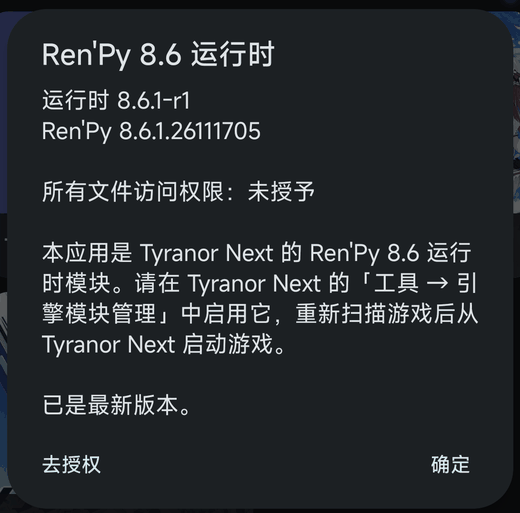

在系统页面里打开「授予管理所有文件的权限」。不同品牌的手机页面文字略有差别，开关打开后返回即可。再次打开运行时，这一行会变成「已授予」。

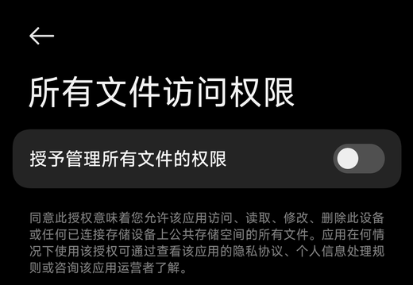 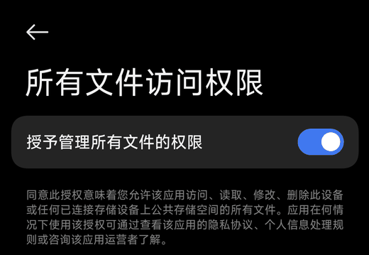

> 忘了这一步也没关系：第一次从 Tyranor Next 启动游戏时，运行时会说明原因并打开同一个系统页面，授权后自动继续启动。

### 2. 在 Tyranor Next 里启用模块

打开 Tyranor Next，进入底栏的「工具」→「引擎模块管理」。列表里会出现「Ren'Py 8.6」，**默认是关闭的**，把开关打开。

（较早的 Tyranor Next 版本没有「工具」页，入口在侧栏「妙妙工具」里：在主界面从屏幕左边缘向内滑，或者从页面空白处向右滑，不是在底部导航栏上滑。）

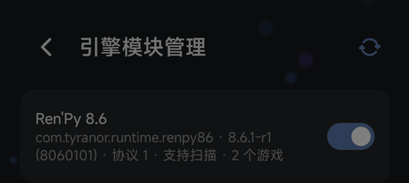 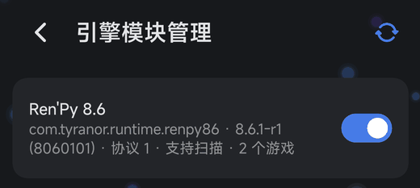

如果列表里没有 Ren'Py 8.6：确认 APK 已经装好，然后点右上角的刷新；仍然没有的话，检查 Tyranor Next 是不是最新版本。

### 3. 扫描游戏

Ren'Py 8.6 及以后版本的游戏，目录里同时有 `game/` 和 `renpy/asynctask.py`（或 `.pyc`）。把游戏放进 Tyranor Next 的游戏目录（「设置 → 游戏目录添加」，「扫描深度」要够得到游戏所在的层级），然后在「游戏」页点右上角的刷新按钮重新扫描。

识别出来的游戏封面是蓝紫色的「Tyranor Plugin」占位图，名字下面不显示模块名。更早版本（8.5 及以前）的 Ren'Py 游戏不会被本运行时认领，仍然由 Tyranor Next 自己的 Ren'Py 运行时处理。

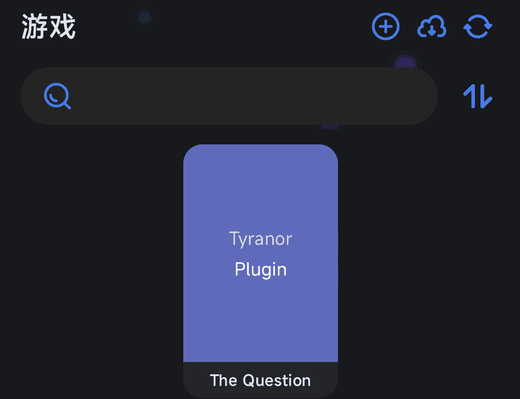

### 4. 启动和设置

点游戏卡片，在抽屉里点「启动游戏」。「引擎设置」是这个游戏自己的设置：

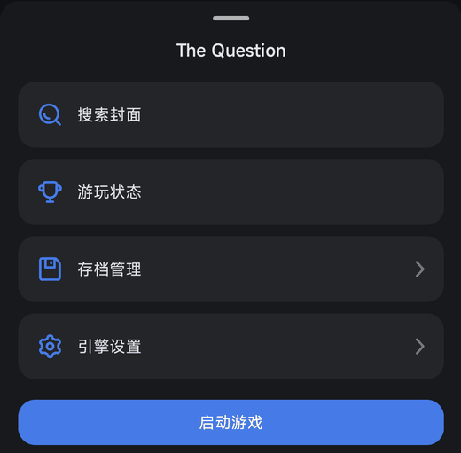 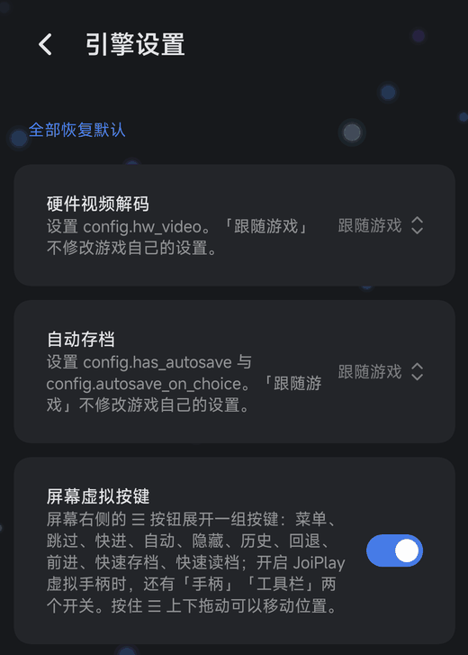

- 硬件视频解码、自动存档：默认「跟随游戏」，不改动游戏自己的设置，也可以强制开或关。
- 屏幕虚拟按键、JoiPlay 虚拟手柄、检查运行时更新：运行时自己的功能，默认都开。

### 5. 游戏里

启动后先是加载画面，实时显示 Ren'Py 现在在做什么（读取脚本、执行初始化代码……），已完成的阶段带耗时。大型游戏要等十秒左右，这个画面能让你知道它没有卡住。

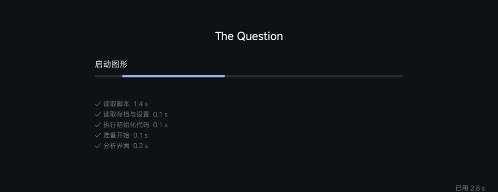

进入游戏后，屏幕右侧有一个 ☰ 按钮，可以上下拖动。点开是一排按键：菜单、跳过、按住快进、自动、隐藏、历史、回退、前进、快存、快读。

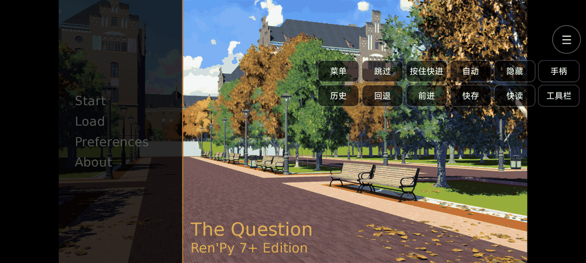

最右一列的「手柄」和「工具栏」是两个开关。「手柄」打开 [JoiPlay 的虚拟手柄](third_party/joiplay)（十字键、A/B/X/Y 等），「工具栏」有关闭、旋转、静音、键盘和手柄设置。手柄的每个键都可以在设置里改，保存在 `<游戏目录>/gamepad.json`，与 JoiPlay 通用。

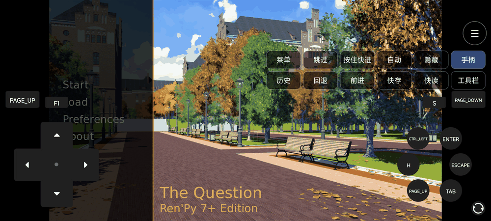

按手机的返回键不会退出游戏，而是交给 Ren'Py（回滚）。

## 工作原理

| 组成部分 | 来源 |
|---|---|
| 引擎、Python、SDL3（`librenpython.so`）、Ren'Py 的 Android Java 代码 | 官方 `renpy-8.6.1-rapt.zip`，未修改 |
| Ren'Py 的 Python 代码、标准库、`renpy/common` | 官方 `renpy-8.6.1-sdk.tar.bz2`，未修改，按 RAPT 的方式布置 |
| `main.py` | Ren'Py 的 `renpy.py`，加上一小段前置代码（[runtime/main_prelude.py](runtime/main_prelude.py)）：传递游戏信息，并向加载画面报告进度 |
| Ren'Py 没有开关的设置项、切后台问题的绕过、虚拟按键的命令 | [runtime/common/00runtime_overrides.rpy](runtime/common/00runtime_overrides.rpy) |
| 启动处理、加载画面、屏幕虚拟按键 | [app/src/main/java](app/src/main/java/studio/tsatoru/renpy86) |
| JoiPlay 虚拟手柄 | [joiplay/joipad](https://github.com/joiplay/joipad) 及其依赖（MIT），见 [third_party/joiplay](third_party/joiplay) |
| 模块描述（扫描、设置、存档） | [app/src/main/res/raw/tyranor_runtime.json](app/src/main/res/raw/tyranor_runtime.json) |

`librenpython` 总是运行 `python main.py`，并忽略命令行参数。所以 `GameActivity` 在 `preparePython()` 里通过环境变量传递游戏信息，再由前置代码转换成 Ren'Py 的常规命令行：`main.py <游戏目录> --savedir <存档目录>`。指定了游戏目录后，Ren'Py 会从文件系统读取游戏，而不是从 APK 里读取。

## 构建

需要：JDK 17 及以上、Android SDK（platform 36）、Python 3.10 及以上，上游压缩包约占 2 GB 磁盘空间。

```sh
python3 tools/prepare.py          # 下载、校验并布置上游运行时
./gradlew :app:testDebugUnitTest :app:assembleDebug
python3 -m unittest discover tests
```

`tools/prepare.py` 会下载 [upstream.lock.json](upstream.lock.json) 中固定的压缩包，用 renpy.org 公布的 SHA-256 校验，然后写入 `build/staging/`。它还会用 Linux 版 Ren'Py SDK 编译 `runtime/common/*.rpy`，所以这一步需要在 Linux x86_64 上进行。

Release 构建使用仓库之外的密钥签名：

```sh
RAR_SIGNING_PROPERTIES=/path/to/signing.properties ./gradlew :app:assembleRelease
```

properties 文件中包含 `storeFile`、`storePassword`、`keyAlias` 和 `keyPassword`。

## 状态

在一台手机（Android 16，骁龙 8s Gen 3，arm64）上用 Ren'Py 8.6 游戏测试过：一款商业规模的游戏（5.6 GB 的 RPA 资源包，含视频和中日文文本），以及 Ren'Py 自带的示例游戏。

r3 按 Tyranor Next 第三方模块的流程验证过：
- 模块能被发现，默认关闭，可以启用；
- 扫描时 8.6 游戏会被识别，而 `script_version` 为 8.5、没有 `renpy/asynctask.py` 的目录不会；
- 单游戏设置可以生效；
- 第一次启动时的存储权限引导、启动、切后台时存档都正常；
- Tyranor Next 的存档管理能看到 `<游戏目录>/saves`。

更早的版本还验证过：画面渲染、触摸、返回键回滚、存档写入 `<游戏目录>/saves`、切后台再返回、切换游戏、重新启动正在运行的游戏、存储权限流程和错误提示。详见 [CHANGELOG.md](CHANGELOG.md)。

已知问题：

- 大型游戏启动较慢：在测试手机上，商业规模的游戏约需 11–13 秒。时间主要花在 Ren'Py 读入全部脚本和执行初始化代码上（都是 CPU 时间，不是存储读取），加载画面会显示进度。

本运行时绕过的上游问题（Android 上的 Ren'Py 8.6.1 + SDL 3.4.18）：

- **Android 16 上按返回会直接关闭游戏。** 以 API 36 为目标的应用只能通过返回分发器收到返回操作，不再收到按键事件，SDL 拦不住它，游戏还在运行时 Activity 就被关掉了。`GameActivity` 注册了一个返回回调，把返回键交给 Ren'Py（回滚）。已报告为 [renpy/renpy#7533](https://github.com/renpy/renpy/issues/7533)。Ren'Py 在 RAPT 中修复了它（renpy-build `5d80c67`），8.6.1 的更新说明也列了这一条，但官方的 `renpy-8.6.1-rapt.zip` 是在这个提交之前构建的，并不包含修复，所以本运行时的回调仍然需要。

已在上游修复、本运行时不再绕过的问题：

- **切到后台时主线程卡 8 秒，而且后台不存档**（[renpy/renpy#7534](https://github.com/renpy/renpy/issues/7534)，[libsdl-org/SDL#16744](https://github.com/libsdl-org/SDL/issues/16744)）。应用暂停期间，只要事件至少每 100 毫秒到达一次，SDL 的 `Android_PumpEvents` 就不会返回，而 Ren'Py 的定时器每 50 毫秒触发一次，于是进入后台的事件要到恢复前台时才送达。8.6.0-r2 至 r4 在 SDL 暂停时停掉 Ren'Py 的定时器；Ren'Py 8.6.1 在 SDL 报告进入后台时自己暂停定时器。

不支持：用 Ren'Py 7（Python 2）制作的游戏、需要其他平台原生 Python 模块的游戏、Live2D（未包含 Cubism 库）。

## 许可证

本仓库中的代码采用 GPL-3.0-or-later 许可（[LICENSE](LICENSE)）。APK 中还包含 Ren'Py 及其构建所用的库，各自遵循自己的许可证，见 [NOTICE.md](NOTICE.md)。

本项目与 Ren'Py、JoiPlay 均无关联。
